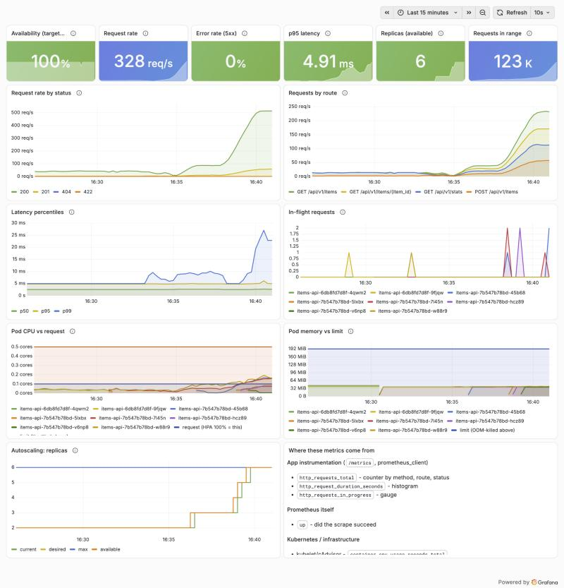
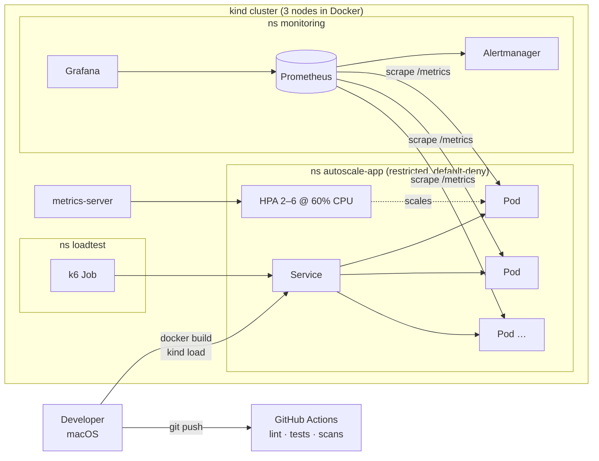
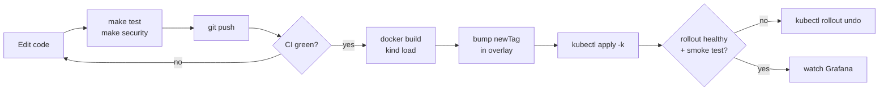
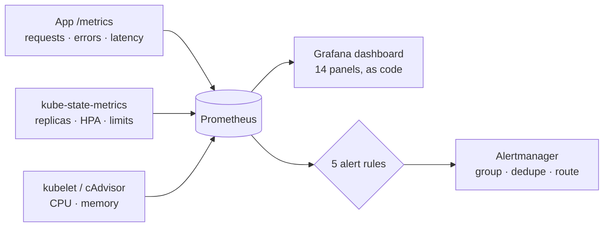

# Cloud-Native Application Deployment and Auto-Scaling Platform

[](https://github.com/Saurabhkaran11/kubernetes-autoscaling-platform/actions/workflows/ci.yml)

This project is a FastAPI service running on a local Kubernetes cluster (kind). It:

- heals itself when pods fail,
- scales with traffic,
- alerts when users are affected,
- rolls back bad releases,
- passes CI security gates on every push.

Everything runs on a Mac for $0. Every number below was measured, not estimated.



*Grafana during the ramp test: traffic rising to about 500 req/s, replicas stepping from 2 to 6, and 0% errors.*

## What it demonstrates (measured results)

- **Autoscaling:** the HPA went from 2 to 6 replicas under a 190,254-request k6 ramp (572 req/s peak) with **0% errors** and p95 10.4 ms, then scaled back to 2 about 3 minutes after the load ended.
- **Self-healing without dropped requests:**
  - Killing a pod under live traffic: **0 failed of 392 requests**.
  - Before the `preStop` pause and readiness probe it was 1–2 failures per kill. The fix was measured, not assumed.
- **Safe releases:**
  - A broken release that passed every health probe was caught by the error-rate alert.
  - The bad route was located from one request ID.
  - `kubectl rollout undo` fixed it, and users saw no errors about 1 minute after the rollback.
- **Real alerting:** 5 Prometheus alerts with **13 promtool unit tests**. Each test was proven able to fail by breaking its rule on purpose. 3 of them also fired and resolved live: the error-rate alert in drills B and D, the latency alert in drill C, and `ItemsApiDown` in a simulated outage.
- **Supply-chain and runtime security:**
  - hash-pinned dependencies (a tampered package fails the build),
  - Trivy and pip-audit gates,
  - non-root, read-only containers under Pod Security "restricted",
  - default-deny NetworkPolicies.
- **CI:** a 3-job GitHub Actions pipeline. It was green on its first GitHub run, with actions pinned to commit SHAs and a read-only token.
- **Honest operations:** one *actual* incident (Grafana OOMKilled) has a blameless postmortem, and its follow-up found and fixed a near-miss.

## The problem it solves

| Problem | Platform answer | Evidence |
|---|---|---|
| Apps crash and stay down | Deployment + probes replace failed pods; `preStop` drains cleanly | [troubleshooting.md](docs/troubleshooting.md) Scenario A |
| Fixed capacity collapses under spikes | HPA on CPU (60% of request), 2–6 replicas | [load-test-results.md](docs/load-test-results.md) |
| Failures are found by users | `/metrics` → Prometheus → alerts → Alertmanager; Grafana dashboard | [monitoring.md](docs/monitoring.md) |
| Releases are risky | CI gates, rolling updates with `maxUnavailable: 0`, `rollout undo` | Scenario D, [ci-cd.md](docs/ci-cd.md) |

## Architecture



### Deployment workflow



### Monitoring and alerting flow



- The full system design, request sequence diagrams and trade-offs are in [docs/architecture.md](docs/architecture.md).

## Tech stack, and why each piece is here

| Layer | Tool | Why it's needed | Simpler alternative |
|---|---|---|---|
| API | Python 3.12, FastAPI, Uvicorn | Typed validation, async, OpenAPI docs | Flask |
| Tests | pytest (62 tests, 100% coverage), promtool | Code and alert rules both tested | unittest |
| Container | Docker (multi-stage, non-root, hash-locked deps) | One artifact for laptop, CI and cluster | — |
| Cluster | kind v0.33 (Kubernetes 1.37), kubectl | Real multi-node Kubernetes, free | Docker Desktop Kubernetes |
| Packaging | Kustomize (source of truth), Helm chart | Overlays; versioned releases and rollbacks | raw `kubectl apply -f` |
| Autoscaling input | metrics-server | The HPA reads CPU from it | — (required) |
| Observability | kube-prometheus-stack: Prometheus, Alertmanager, Grafana | Metrics, alerts, dashboards | Prometheus in Docker Compose |
| Load | k6 (in-cluster Job) | Ramps, thresholds, repeatable runs | `hey` |
| CI | GitHub Actions | Free CI next to the code | pre-commit hooks |
| Security | Trivy, pip-audit, ruff (bandit rules), NetworkPolicy, Pod Security | Image, dependency, config and network controls | Dependabot alerts |

## Quick start (macOS)

The full guide, with every step's expected output, is [docs/deployment.md](docs/deployment.md). The short path:

**1. Prerequisites.**

```bash
brew install kind helm k6 kubernetes-cli trivy
```

```bash
./scripts/check-prereqs.sh
```

- **Expected:** `All required tools present.`
- Docker Desktop must be running, with at least 4 CPUs, 6 GB of RAM and **20 GB of free disk**.

**2. App and tests.**

```bash
make install
```

```bash
make test
```

- **Expected:** `62 passed` and `TOTAL ... 100%`.

**3. Cluster, metrics, app.**

```bash
kind create cluster --config k8s/kind-config.yaml
```

```bash
kubectl apply -k k8s/addons/metrics-server
```

```bash
docker build -t items-api:v4 --build-arg APP_VERSION=0.4.0 .
```

```bash
kind load docker-image items-api:v4 --name autoscale
```

```bash
kubectl apply -k k8s/overlays/local
```

```bash
kubectl -n autoscale-app rollout status deploy/items-api
```

- **Expected:** `successfully rolled out`, and `kubectl -n autoscale-app get hpa` shows a number like `cpu: 4%/60%`.
- **If you see `<unknown>`:** metrics-server isn't ready yet. Wait about 1 minute.
- **If you see `ErrImagePull`:** the image wasn't loaded into kind. Repeat the `kind load` step.

**4. Monitoring.**

```bash
kubectl create namespace monitoring
```

```bash
kubectl -n monitoring create secret generic grafana-admin --from-literal=admin-user=admin --from-literal=admin-password="$(openssl rand -base64 18)"
```

```bash
helm repo add prometheus-community https://prometheus-community.github.io/helm-charts
```

```bash
helm upgrade --install monitoring prometheus-community/kube-prometheus-stack --version 92.9.0 -n monitoring -f monitoring/values-local.yaml --wait --timeout 10m
```

```bash
kubectl apply -k monitoring
```

```bash
kubectl -n monitoring port-forward svc/monitoring-grafana 3000:80
```

- Open http://localhost:3000/d/items-api/items-api-health.
- Get the password with `kubectl -n monitoring get secret grafana-admin -o jsonpath='{.data.admin-password}' | base64 -d`.

**5. Load test and watch it scale.**

```bash
SETTLE=300 ./scripts/run-load-test.sh ramp
```

- **Expected:** replicas rise from 2 to 6, the output ends with `thresholds: PASSED`, and replicas fall back to 2 afterwards.

**6. Clean up.**

```bash
kind delete cluster --name autoscale
```

## Everyday commands

| Task | Command |
|---|---|
| Lint / format | `make lint` / `make format` |
| Unit tests with coverage | `make test` |
| Alert-rule unit tests | `make test-alerts` |
| All security gates | `make security` |
| Helm chart lint + equivalence check | `make helm-check` |
| Re-pin dependencies | `make lock` |
| Run the API locally | `make run`, then http://localhost:8000/docs |
| Pod-failure drill | `./scripts/pod-kill-drill.sh` |
| Smoke / ramp / steady load | `./scripts/run-load-test.sh smoke\|ramp\|steady` |

## API

| Method | Path | Success | Errors |
|---|---|---|---|
| GET | `/health` | `200 {"status":"ok"}` (liveness) | — |
| GET | `/ready` | `200 {"status":"ready"}` (readiness) | `503` while starting or shutting down |
| GET | `/metrics` | Prometheus text format | — |
| GET | `/api/v1/items?limit=50&offset=0` | `200` list | `422` bad paging |
| POST | `/api/v1/items` | `201` + `Location` | `422` invalid body |
| GET | `/api/v1/items/{item_id}` | `200` item | `404` missing, `422` bad id |
| GET | `/api/v1/stats` | `200` pod, version, count, uptime, active faults | — |

- **Request IDs:** every response has an `X-Request-ID`, which also appears in that request's JSON log line.
- **Server errors:** a 500 returns a generic message, and stack traces go only to the logs.

### Configuration (environment variables)

| Variable | Default | Purpose |
|---|---|---|
| `APP_NAME` | `items-api` | Name reported in `/api/v1/stats` |
| `APP_VERSION` | set at image build (`--build-arg APP_VERSION`) | Version reported in stats and logs |
| `APP_LOG_LEVEL` | `INFO` | `DEBUG`, `INFO`, `WARNING`, `ERROR` |
| `POD_NAME` | hostname (Kubernetes: the pod name) | Replica name in stats and logs |
| `APP_SEED_ITEMS` | `true` | Create 3 demo items at startup |
| `FAULT_ERROR_RATE` | `0` (off) | **Drills only:** share of `/api/*` requests that return 500 (0.0–1.0) |
| `FAULT_LATENCY_MS` | `0` (off) | **Drills only:** extra delay on every `/api/*` request |

- Invalid fault values stop the app at startup.
- In Kubernetes these come from the ConfigMap (`k8s/overlays/local`) or the Helm `config:` values.

## Repository layout

```
kubernetes-autoscaling-platform/
├── app/                      FastAPI service: routes, metrics middleware, JSON logging, fault injection
├── tests/test_app.py         all 62 unit tests in one file
├── Dockerfile                multi-stage, non-root, installs from requirements.lock with --require-hashes
├── docker-compose.yml        API + Prometheus without Kubernetes (docker/prometheus.yml)
├── requirements*.txt / .lock direct deps / dev tools / every dep hash-pinned (make lock)
├── k8s/
│   ├── kind-config.yaml      3-node cluster, Kubernetes v1.37.0 pinned by digest
│   ├── base/                 namespace, deployment, service, HPA, NetworkPolicies (Kustomize)
│   ├── overlays/local/       image tag + config for kind
│   └── addons/metrics-server pinned v0.9.0 + kind TLS patch
├── helm/items-api/           the same workload as a Helm chart (make helm-check proves equivalence)
├── monitoring/               Helm values, ServiceMonitor, alert rules + promtool tests, Grafana dashboard JSON
├── load-tests/               k6 smoke / ramp / steady scripts, run in-cluster as a Job
├── scripts/                  prereq check, load-test runner, pod-kill drill, regression image, helpers
├── .github/workflows/ci.yml  lint + tests, alert-rule tests, build + scans
└── docs/                     design, guides, evidence, postmortem, portfolio notes, screenshots
```

**Changes from the original plan, and why:**

- **`requirements-dev.txt` and `requirements.lock`:** test tools stay out of the image, and every runtime package is hash-pinned.
- **`k8s/addons/`:** cluster add-ons are kept apart from the app.
- **`load-tests/` is a Kustomize tree:** k6 runs inside the cluster so traffic spreads across replicas.

## Documentation

| Document | What's in it |
|---|---|
| [architecture.md](docs/architecture.md) | Specification, system design, sequence diagrams, design trade-offs |
| [deployment.md](docs/deployment.md) | Step-by-step macOS guide with expected output and error hints |
| [docker.md](docs/docker.md) | Image design, Docker concepts, measured results |
| [kubernetes.md](docs/kubernetes.md) | Kubernetes concepts, operations cheat-sheet, probes/HPA/rollout evidence |
| [monitoring.md](docs/monitoring.md) | Metric sources, alert rules, live alert test, dashboard |
| [load-test-results.md](docs/load-test-results.md) | k6 results and how CPU, requests, the HPA and latency relate |
| [troubleshooting.md](docs/troubleshooting.md) | Triage flow and failure drills A–D with measured timelines |
| [incident-postmortem.md](docs/incident-postmortem.md) | Blameless postmortem of an **actual** incident |
| [ci-cd.md](docs/ci-cd.md) | Pipeline, local validation, first GitHub run, secure deployment design |
| [security.md](docs/security.md) | Controls with evidence, scan gates, accepted risks, known limits |
| [acceptance.md](docs/acceptance.md) | The 15 acceptance criteria and the evidence for each |
| [portfolio.md](docs/portfolio.md) | Resume bullets, a 5-minute demo script, how to capture evidence |
| [interview-prep.md](docs/interview-prep.md) | 25 questions with design reasoning, 8 troubleshooting scenarios, 5 system-design questions |

## Known limitations

- **In-memory data:** it's lost on restart, and each replica has its own copy. A `POST` to one pod isn't visible on another.
- **Local cluster only:** there's no cloud load balancer or real ingress, and you reach the app through port-forward.
- **CPU-only autoscaling:** it's blind to I/O-bound slowness. During Scenario C, the HPA *scaled down* while latency rose.
- **Laptop numbers:** k6 shares CPUs with the cluster. The results show behaviour, not production capacity.
- **Not production-secure:** no TLS, no API authentication, no image signing. See [security.md](docs/security.md) §4.

## Future improvements

- **Persistence:** PostgreSQL or Redis behind the API, so data survives restarts and is shared between replicas.
- **Better scaling:** scale on request rate or in-flight requests with KEDA or prometheus-adapter, and test with an open-model load (`constant-arrival-rate`).
- **Safer releases:** progressive delivery (Argo Rollouts or Flagger) with automatic rollback on error rate.
- **GitOps:** Argo CD or Flux pulling from git, so CI never needs cluster credentials.
- **Supply chain:** sign images with cosign, publish SBOMs, and verify at admission with Kyverno.
- **Edge:** an ingress with TLS, rate limiting and authentication.
- **Tracing:** OpenTelemetry tracing, linked to the existing request IDs.
