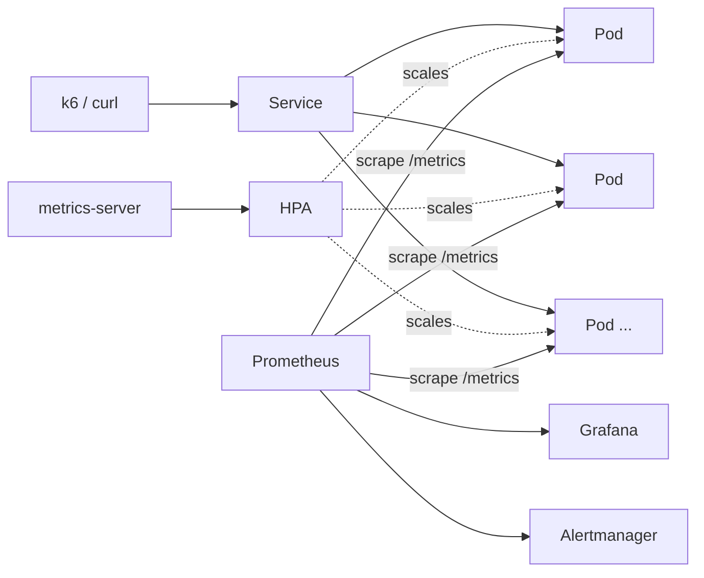
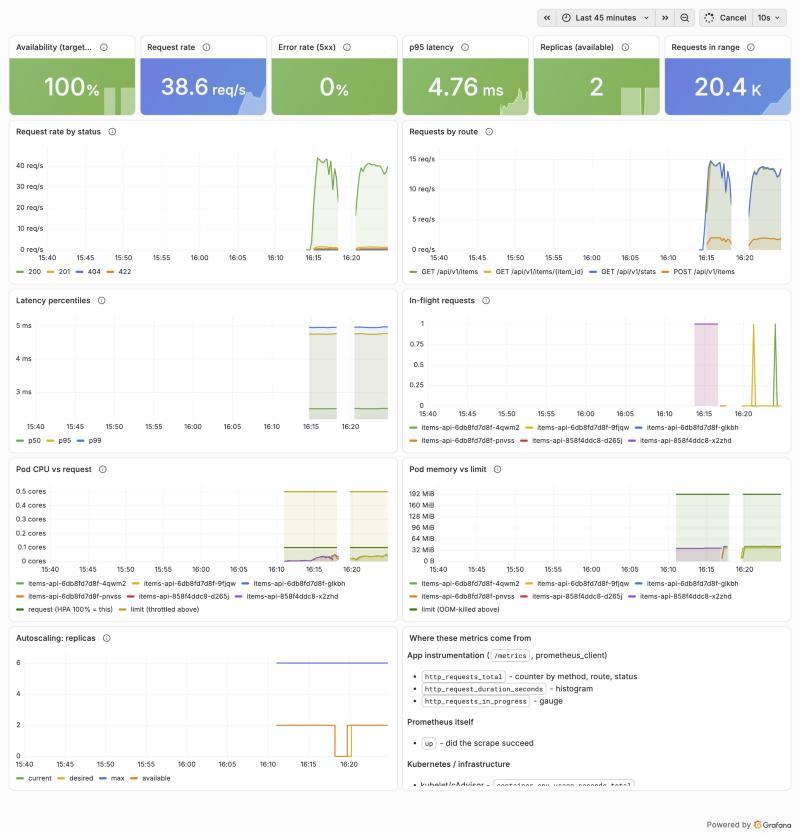

# Cloud-Native Application Deployment and Auto-Scaling Platform

A FastAPI service, containerised, deployed to local Kubernetes (kind), monitored with Prometheus and Grafana, scaled by a Horizontal Pod Autoscaler and gated by GitHub Actions CI. It runs entirely on a laptop for $0.

## The problem

- Apps crash and stay down.
- Fixed capacity collapses under traffic spikes.
- Teams find out about failures from users.
- Releases are risky without tests and fast rollback.

This project shows how a platform fixes each of these: self-healing pods, autoscaling, metrics and alerts, and CI with rolling updates and rollbacks.

## Project status

| Phase | Status |
|---|---|
| 1. Requirements, architecture, setup | ✅ done |
| 2. FastAPI app + tests | ✅ done — 47 tests, 100% coverage |
| 3. Docker | ✅ done — 227 MB non-root image, Compose + Prometheus |
| 4. Kubernetes basics | ✅ done — kind 3-node cluster, Kustomize, self-healing measured |
| 5. Probes, limits, HPA | ✅ done — 0 failed requests per pod kill, HPA 2→6→2, rollback measured |
| 6. Prometheus + Grafana + alerts | ✅ done — 21/21 panels backed by real data, 11 promtool tests, live alert fired and resolved |
| 7. Load tests + failure drills | ⏳ next |
| 8–10 | pending — see [docs/roadmap.md](docs/roadmap.md) |

## Architecture at a glance



- Full system design, sequence diagrams and trade-offs are in [docs/architecture.md](docs/architecture.md).
- Step-by-step deployment for anyone is in [docs/deployment.md](docs/deployment.md).
- Docker concepts, security measures and measured results are in [docs/docker.md](docs/docker.md).
- Kubernetes concepts, operations and drill results are in [docs/kubernetes.md](docs/kubernetes.md).
- Monitoring, alert rules and evidence are in [docs/monitoring.md](docs/monitoring.md).



## API

| Method | Path | Success | Errors |
|---|---|---|---|
| GET | `/health` | `200 {"status":"ok"}` | — |
| GET | `/ready` | `200 {"status":"ready"}` | `503` while starting or shutting down |
| GET | `/metrics` | `200` Prometheus text | — |
| GET | `/api/v1/items?limit=50&offset=0` | `200 [items]` | `422` bad paging |
| POST | `/api/v1/items` | `201` + `Location` header | `422` invalid body |
| GET | `/api/v1/items/{item_id}` | `200 item` | `404` missing, `422` bad id |
| GET | `/api/v1/stats` | `200` pod, count, uptime | — |

- Every response carries an `X-Request-ID` header, which also appears in the JSON log line for that request.
- Unhandled errors return `500 {"detail":"Internal server error","request_id":...}`. The stack trace goes only to the logs.
- Interactive docs are at http://localhost:8000/docs while the app runs.

### Run and test locally

```bash
make install
```

```bash
make test
```

```bash
make lint
```

```bash
make run
```

### Configuration (environment variables)

| Variable | Default | Purpose |
|---|---|---|
| `APP_NAME` | `items-api` | Name reported in `/api/v1/stats` |
| `APP_VERSION` | `0.1.0` | Version reported in stats and logs |
| `APP_LOG_LEVEL` | `INFO` | `DEBUG`, `INFO`, `WARNING`, `ERROR` |
| `POD_NAME` | hostname | Replica name in stats and logs |
| `APP_SEED_ITEMS` | `true` | Create 3 demo items at startup |
| `FAULT_ERROR_RATE` | `0` (off) | **Drills only:** share of `/api/*` requests that return 500 (0.0–1.0) |
| `FAULT_LATENCY_MS` | `0` (off) | **Drills only:** extra delay on every `/api/*` request |

## Tech stack, and why each piece is here

| Layer | Tool | Why it's needed | Simpler alternative |
|---|---|---|---|
| API | Python, FastAPI, Uvicorn | Typed validation, async, OpenAPI docs | Flask |
| Tests | Pytest | Standard Python test runner | unittest |
| Container | Docker | Same artifact runs on laptop, CI and cluster | none, if you skip Kubernetes |
| Cluster | kind, kubectl | Real Kubernetes inside Docker, free | Docker Desktop's built-in k8s |
| Packaging | Kustomize, Helm | Environment overlays; versioned releases | raw `kubectl apply -f` |
| Metrics for HPA | metrics-server | HPA reads CPU from it | — (required) |
| Monitoring | Prometheus, Grafana, Alertmanager | Time-series metrics, dashboards, alerts | Docker Compose Prometheus only |
| Load | k6 | Ramping load with pass/fail thresholds | `hey` |
| CI | GitHub Actions | Free CI next to the code | pre-commit hooks only |
| Security | Trivy, pip-audit, ruff | Image CVEs, dependency CVEs, lint | Dependabot alerts |

## Repository layout

```
kubernetes-autoscaling-platform/
├── app/                  # FastAPI source: main.py, routes/, metrics.py, logging_config.py
├── tests/                # one consolidated pytest file for every use case
├── docker/               # Compose extras (e.g. local Prometheus config)
├── k8s/
│   ├── kind-config.yaml  # 3-node local cluster definition
│   ├── base/             # Namespace, Deployment, Service, ConfigMap, HPA
│   └── overlays/local/   # Kustomize patches for the kind cluster
├── helm/items-api/       # the same app packaged as a Helm chart
├── monitoring/
│   ├── prometheus/       # ServiceMonitor (what to scrape)
│   ├── grafana/dashboards/ # dashboard JSON (dashboards as code)
│   └── alerts/           # PrometheusRule alert definitions
├── load-tests/           # k6 scripts
├── scripts/              # helper scripts (check-prereqs.sh, demo drills)
├── .github/workflows/    # CI pipeline
├── docs/                 # architecture, deployment, troubleshooting, postmortem, images/
├── Dockerfile
├── docker-compose.yml
├── requirements.txt      # runtime deps (pinned)
├── requirements-dev.txt  # test/lint deps (pinned)  — added vs. the original plan
├── .dockerignore
├── .gitignore
└── README.md
```

Two changes from the original layout, and why:

- **`requirements-dev.txt`** — keeps pytest and ruff out of the production image, which makes it smaller and gives it less attack surface.
- **`helm/items-api/`** — Helm expects one chart per folder.

## Quick start

```bash
./scripts/check-prereqs.sh
```

Then follow [docs/deployment.md](docs/deployment.md).

## Known limitations (so far)

- In-memory data: it is lost on restart, and each replica holds its own copy.
- Local cluster only: no cloud load balancer, and you reach the app through port-forward.
- Not production-secure: the hardening applied is listed in `docs/security.md` (Phase 8).
