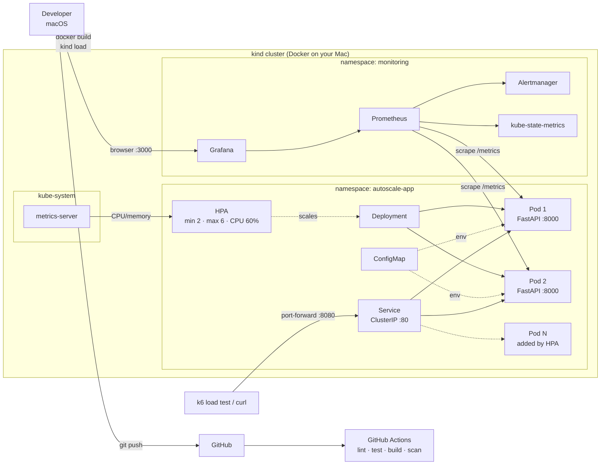
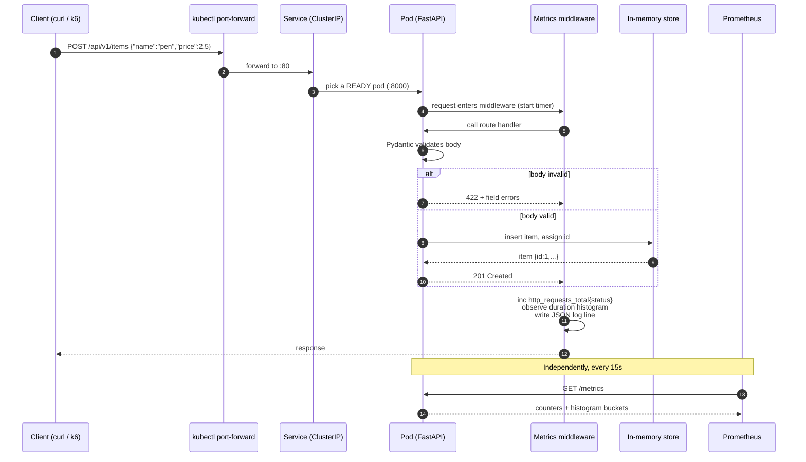
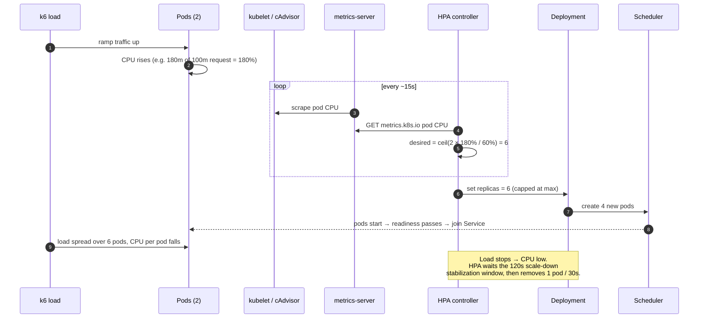
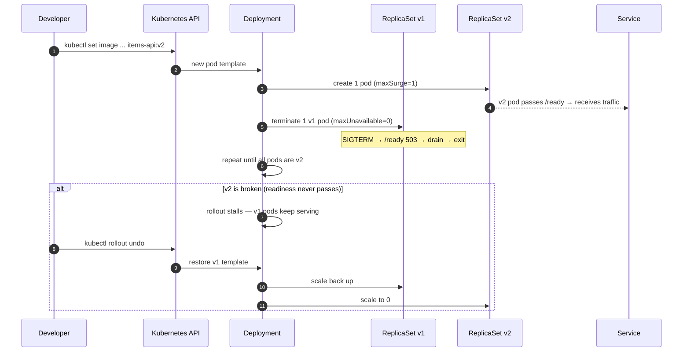
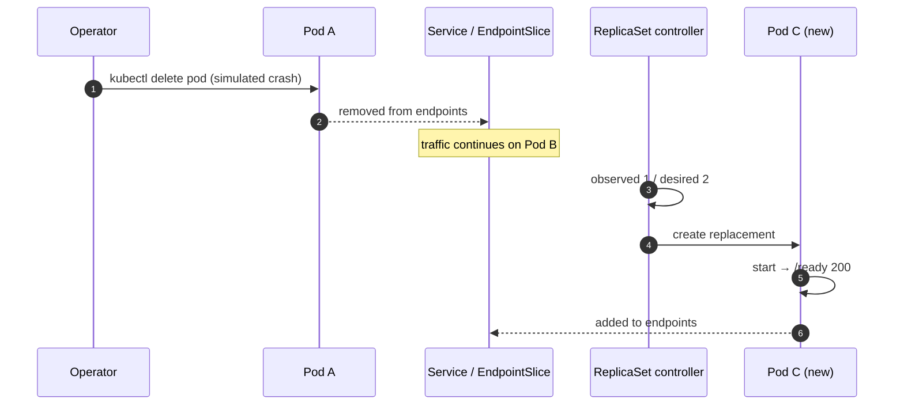
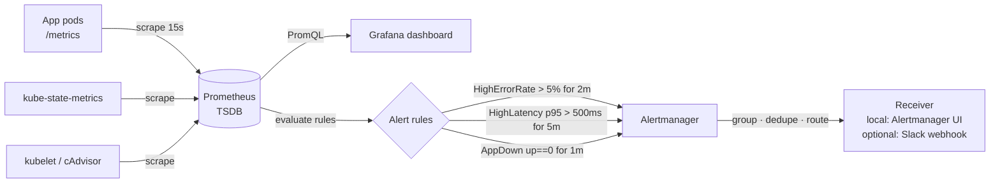
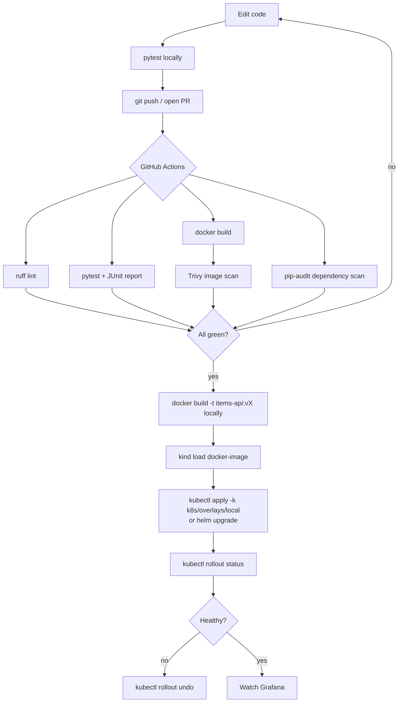

# Architecture and System Design

## 1. Project in a few lines

- **What it is:** a small FastAPI "items" service, packaged as a container, deployed to a local Kubernetes cluster (kind), watched by Prometheus/Grafana, and scaled automatically by a Horizontal Pod Autoscaler.
- **What it proves:** you can take code from `git push` to a self-healing, self-scaling, observable deployment — and you can debug it when it breaks.
- **What it is not:** a product. The API is deliberately simple so the platform around it is the focus.

## 2. The problem we are solving

A single app process on a single machine has four failure modes that every real team hits:

- **It crashes and stays down** until a human restarts it.
- **It slows down or falls over under traffic spikes**, because capacity is fixed.
- **Nobody knows it is unhealthy** until users complain, because there are no metrics or alerts.
- **Every release is risky**, because there is no automated test gate and no fast rollback.

This project answers each one with a platform mechanism:

| Problem | Mechanism | Where it lives |
|---|---|---|
| Crashes stay down | Deployment + liveness probe restart pods automatically | `k8s/base/deployment.yaml` |
| Fixed capacity | HPA adds/removes replicas based on CPU | `k8s/base/hpa.yaml` |
| No visibility | `/metrics` + Prometheus + Grafana + alerts | `app/metrics.py`, `monitoring/` |
| Risky releases | CI tests/scans every push; rolling update + `kubectl rollout undo` | `.github/workflows/`, `docs/deployment.md` |

## 3. Project specification

### 3.1 Functional requirements

| Endpoint | Purpose | Success | Failure |
|---|---|---|---|
| `GET /health` | Liveness — "the process is alive" | `200 {"status":"ok"}` | process hung → probe times out |
| `GET /ready` | Readiness — "send me traffic" | `200 {"status":"ready"}` | `503` during startup/shutdown |
| `GET /metrics` | Prometheus text exposition | `200 text/plain` | — |
| `GET /api/v1/items` | List items | `200 [...]` | — |
| `POST /api/v1/items` | Create item (validated) | `201 {...}` | `422` invalid body |
| `GET /api/v1/items/{item_id}` | Get one item | `200 {...}` | `404` not found, `422` bad id |
| `GET /api/v1/stats` | Item count, uptime, pod name | `200 {...}` | — |

### 3.2 Non-functional requirements

- **Availability:** survives the loss of any single pod with no failed requests visible to clients (≥2 replicas, readiness gating).
- **Scalability:** HPA scales 2 → 6 replicas when average CPU > 60% of the request (measured: 2→6 in 15 s; back to 2 about 3.5 min after load).
- **Observability:** request count, rate, error rate, p50/p95/p99 latency, pod CPU/memory, replica count — all on one dashboard.
- **Graceful shutdown:** on `SIGTERM`, `/ready` returns 503, in-flight requests finish, then the process exits.
- **Security:** non-root container, read-only root filesystem, dropped Linux capabilities, no secrets in the image, scanned dependencies and image.
- **Cost:** $0 — everything runs on a laptop.

### 3.3 Explicit constraints and limitations

- **In-memory data store.** Items live in a Python dict inside each pod. Data is lost on restart, and each replica has its *own* copy, so a `POST` to pod A is not visible from pod B. This is intentional for the MVP: it keeps the focus on the platform. It is documented as a known limitation and is the first "future improvement" (add Redis or Postgres).
- **Local cluster only.** kind runs Kubernetes nodes as Docker containers. There is no real cloud load balancer; we reach services through `kubectl port-forward` or an ingress controller mapped to localhost.
- **Laptop-sized load.** Load test numbers measure this laptop, not production capacity.

## 4. High-level architecture

### Component responsibilities

- **FastAPI app** — serves the API, exposes `/health`, `/ready`, `/metrics`, logs JSON to stdout.
- **Deployment** — keeps N identical pods running; replaces crashed pods; performs rolling updates.
- **Service** — one stable virtual IP + DNS name (`items-api.autoscale-app.svc`) load-balancing across *ready* pods only.
- **ConfigMap** — non-secret settings (log level, app name) injected as env vars, so the same image runs in any environment.
- **metrics-server** — collects pod CPU/memory from kubelets and serves the `metrics.k8s.io` API. **The HPA cannot work without it**, and kind does not ship it.
- **HPA** — every 15s compares average CPU (as % of the pod's CPU *request*) to the target and changes `replicas`.
- **Prometheus** — scrapes app metrics and cluster metrics, stores time series, evaluates alert rules.
- **kube-state-metrics** — exposes Kubernetes object state (desired/available replicas, HPA status) to Prometheus.
- **Grafana** — dashboards on top of Prometheus.
- **Alertmanager** — receives firing alerts from Prometheus, groups and routes them (locally: shown in its UI).

### Where every metric comes from

| Metric | Source | Type |
|---|---|---|
| `http_requests_total{method,path,status}` | App instrumentation (`prometheus_client`) | Counter |
| `http_request_duration_seconds` | App instrumentation | Histogram |
| `http_requests_in_progress` | App instrumentation | Gauge |
| Request rate, error rate | PromQL `rate()` over the counter | Derived |
| p95 latency | PromQL `histogram_quantile()` | Derived |
| `up{job="items-api"}` (availability) | Prometheus itself, per scrape | Built-in |
| `container_cpu_usage_seconds_total`, `container_memory_working_set_bytes` | kubelet / cAdvisor | Infrastructure |
| `kube_deployment_status_replicas_available`, `kube_horizontalpodautoscaler_status_current_replicas` | kube-state-metrics | Infrastructure |
| HPA's own CPU reading | metrics-server (not Prometheus) | Infrastructure |

## 5. Sequence diagrams

### 5.1 A client request (happy path and metrics)

### 5.2 Autoscaling loop (HPA)

### 5.3 Rolling update and rollback

### 5.4 Pod failure and self-healing

## 6. Monitoring and alerting flow

## 7. Deployment workflow (code → cluster)

Deployment from CI to the cluster is **not** automated in the first version: a GitHub-hosted runner cannot reach a kind cluster on your laptop, and automating it securely needs a reachable cluster plus scoped credentials. That is a documented future improvement.

## 8. Key design decisions and trade-offs

| Decision | Why | Trade-off / simpler alternative |
|---|---|---|
| **FastAPI + Uvicorn** | Async, typed, automatic validation and OpenAPI docs | Flask is simpler but you hand-write validation |
| **Single Uvicorn worker per pod** | Kubernetes is the process manager; scale with pods, not workers, so HPA CPU math stays honest | Gunicorn with N workers gives more per-pod throughput but hides load from the HPA |
| **In-memory store** | Zero dependencies; focus stays on the platform | Inconsistent across replicas; Redis/Postgres fixes that |
| **kind** over minikube/Docker Desktop k8s | Multi-node, fast, same tool many CI systems use | minikube has more add-ons built in; Docker Desktop k8s is one click but single-node |
| **Kustomize base + overlays** as source of truth, Helm chart as packaging exercise | Kustomize is plain YAML you can read; Helm teaches templating/releases | Maintaining both is duplication — acceptable for learning, not for a real team |
| **kube-prometheus-stack via Helm** | One install gives Prometheus, Alertmanager, Grafana, kube-state-metrics, node-exporter | Heavy for a laptop (~1.5 GB RAM); a bare Prometheus + Grafana via Docker Compose is lighter |
| **HPA on CPU** | Built in, needs only metrics-server | CPU is a proxy for load; request-rate scaling needs prometheus-adapter or KEDA |
| **k6** for load | Scriptable in JS, thresholds turn a load test into a pass/fail check | `hey` or `ab` are one-liners but give no ramping or thresholds |
| **Trivy + pip-audit** | Free, fast, run in CI | Snyk/Dependabot add PR automation |

## 9. Capacity math (why requests matter for the HPA)

- The HPA target is a **percentage of the CPU request**, not of the node.
- Example: request `100m`, target `60%` → HPA aims for 60m per pod on average.
- If 2 pods average 150m: `desired = ceil(2 × 150 / 60) = 5` replicas.
- If the request were `500m`, the same 150m is only 30% → **no scaling**. Wrong requests silently break autoscaling.
- Limits cap usage (CPU is throttled, memory over-limit is OOM-killed). We set CPU limit higher than the request so pods can burst.
