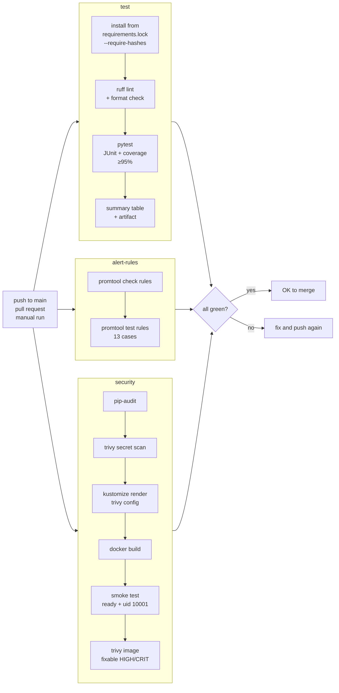

# CI/CD

## 1. The pipeline (`.github/workflows/ci.yml`)



| Requirement | Where |
|---|---|
| 1. Check out the repository | `actions/checkout`, pinned to a commit SHA, with `persist-credentials: false` |
| 2. Set up Python | `actions/setup-python` 3.12, with pip cache keyed on the lock files |
| 3. Install dependencies | `pip install --require-hashes --no-deps -r requirements.lock`, then dev tools |
| 4. Linting | `ruff check --output-format=github` (inline PR annotations) and `ruff format --check` |
| 5. Unit tests | `pytest` with `--cov-fail-under=95` |
| 6. Build the Docker image | `docker build` in the `security` job, then a smoke test of the built image |
| 7. Security checks | pip-audit, trivy secret / config / image ([security.md](security.md)) |
| 8. Publish test results | Markdown table on the run's Summary page, plus a `test-results` artifact (JUnit XML, coverage XML, kept 14 days) |

**Why three parallel jobs:**

- They are independent, so the pipeline takes as long as the slowest job, not the sum of all three.
- A failure shows straight away *which kind* of check broke.

**Why the test summary uses no extra action:** annotation actions need `checks: write`. A few lines of Python writing to `$GITHUB_STEP_SUMMARY` need no permissions at all.

## 2. Validating the workflow locally before pushing

All of these were run on 2026-10-15:

| Check | Command | Result |
|---|---|---|
| Workflow syntax, expressions and embedded shell | `actionlint` (with `shellcheck`) | **0 errors** |
| `test` job, exact commands, in Linux | `python:3.12-slim` container running the job's `run:` steps | hash-checked install OK; ruff clean; **62 passed, 100% coverage**; summary table rendered |
| `alert-rules` job | `make test-alerts PROMETHEUS_IMAGE=<digest-pinned>` | `SUCCESS` (8 rules, 13 cases) |
| `security` job | `make security` (same Trivy 0.76.0 and flags, Homebrew binary instead of the container image) plus the build and smoke-test steps verbatim | all 4 gates pass; smoke: ready, uid 10001 |
| Full run under `act` | `act -j test -P ubuntu-24.04=-self-hosted` | **Not completed.** See below. |

**Why `act` wasn't used for a full run:**

- `act` normally runs jobs in a Linux runner image of about 1.5 GB. This Mac had about 8 GB free, below the level where Docker's storage failed earlier (see [troubleshooting.md](troubleshooting.md)).
- `act`'s self-hosted mode avoids the image, but runs steps directly on macOS, where `actions/setup-python` fails because it expects a GitHub-hosted runner layout.
- With 20+ GB free, use:

```bash
act -j test
```

```bash
act -j alert-rules
```

```bash
act -j security
```

**The real end-to-end proof is the first run on GitHub.** This repository has no remote yet (commits are local by choice).

## 3. Running it on GitHub (when you're ready)

```bash
gh repo create kubernetes-autoscaling-platform --private --source . --remote origin
```

```bash
git push -u origin main
```

```bash
gh run watch
```

- **Expected:** the three jobs `Lint and unit tests`, `Prometheus alert rule tests` and `Build image and security scans` all go green.
- The Summary page shows the unit-test table, and the `test-results` artifact appears on the run.

## 4. Deployment automation: designed, deliberately not built

The CI workflow never deploys. Adding CD here would be pretend:

- **GitHub can't reach the cluster.** A GitHub-hosted runner has no path to a kind cluster on a laptop.
- **Opening one would be worse.** Exposing the laptop's API server to the internet, or storing a kubeconfig as a repository secret, creates a much bigger risk than the convenience is worth.

For a real cluster, deployment would be a **separate workflow**, with these security requirements:

| Concern | Design |
|---|---|
| Separation | `deploy.yml`, separate from `ci.yml`, triggered only by a successful CI run on `main` (`workflow_run`) or a release tag. Never by pull requests from forks. |
| Image publishing | Push to GHCR with the built-in `GITHUB_TOKEN`, granting `packages: write` **only to that job**. Tag images with the commit SHA, never `latest`. |
| Supply chain | Sign the image with cosign (keyless, via OIDC), generate an SBOM, and verify the signature at admission in the cluster (Kyverno or a policy controller). |
| Cluster credentials | **No long-lived kubeconfig in secrets.** Use OIDC federation (`id-token: write`) to a cloud provider's short-lived role, scoped to one namespace with a namespaced RBAC Role. |
| Human approval | A GitHub **Environment** called `production` with required reviewers and a branch rule, so only `main` can deploy. |
| Rollout safety | Update `newTag` in the overlay (GitOps), then `kubectl rollout status` with a timeout, and run `load-tests/smoke.js` against the new version. If either fails, `kubectl rollout undo`. Better: Argo CD or Flux pulls from git, so CI never holds cluster credentials. |
| Audit | Every deploy is a commit (the tag bump) plus a workflow run linked to it. |

The **GitOps** option (Argo CD or Flux running *inside* the cluster and pulling from git) removes the biggest risk entirely: CI never needs credentials for the cluster. That is the recommended design.
