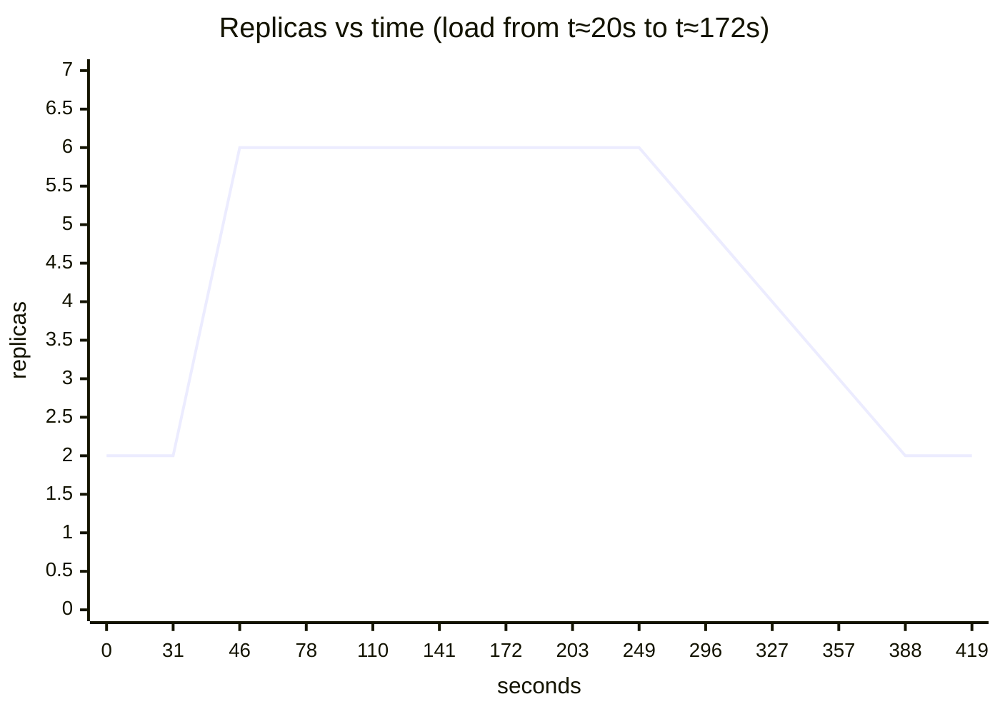

# Kubernetes: Concepts, Operations and Evidence

The "Evidence" sections record what was observed on 2026-10-15.

- kind v0.33.0 running Kubernetes v1.37.0.
- 1 control-plane node and 2 workers.
- kubectl v1.37.1.
- Docker Desktop with 8 CPUs and 7.8 GB.

## 1. What is deployed (Phase 4)

| Object | File | Why it exists |
|---|---|---|
| Namespace `autoscale-app` | `k8s/base/namespace.yaml` | Isolates names and policies. Enforces the Pod Security "restricted" level. |
| ConfigMap `items-api-config-<hash>` | generated in `k8s/base/kustomization.yaml` | Non-secret settings as env vars. The hash in the name triggers a rollout when the config changes. |
| Deployment `items-api` | `k8s/base/deployment.yaml` | 2 replicas, rolling-update strategy, hardened security context, spread across nodes. |
| Service `items-api` | `k8s/base/service.yaml` | Stable ClusterIP and DNS name that load-balances to Ready pods. |

- **Not yet added (Phase 5):** readiness/liveness probes, CPU/memory requests and limits, `preStop` hook, HPA, metrics-server.
- **How Kustomize is used:**
  - `k8s/base/` holds the manifests that are the same everywhere.
  - `k8s/overlays/local/` sets the image tag and local config.
  - Render the result with `kubectl kustomize k8s/overlays/local`.

## 2. Concepts, tied to this project

### Cluster, nodes, pods

- **Node:** a machine that runs pods. In kind, each node is a Docker container (`docker ps` shows `autoscale-worker`).
- **Control plane:** the API server, scheduler, controllers and etcd. Everything else talks to the API server, and `kubectl` is just an API client.
- **Pod:** the smallest unit Kubernetes runs. It holds one or more containers sharing an IP. Pods are disposable: Kubernetes replaces them, it doesn't repair them.

### Deployment → ReplicaSet → Pod

- You declare the desired state (`replicas: 2`, `image: items-api:v1`).
- The ReplicaSet controller continually compares desired with actual, and creates or deletes pods to match. This is the **reconciliation loop**, and it's why a deleted pod comes back.
- Changing the pod template (image, env, ConfigMap name) creates a new ReplicaSet, and pods shift over gradually. That's a **rolling update**, demonstrated in Phase 5.

### Labels and selectors

- The Deployment owns pods labelled `app.kubernetes.io/name=items-api`, and the Service sends traffic to pods with the same label.
- Labels are how loosely coupled objects find each other. A typo in a selector means a Service with zero endpoints.

### Service and DNS

- **ClusterIP:** a virtual IP. Every node's kube-proxy programs rules that spread connections across the ready endpoints.
- **DNS:** `items-api.autoscale-app.svc.cluster.local`. Short form `items-api` works within the same namespace.
- **EndpointSlice:** the live list of pod IPs behind a Service. `kubectl get endpointslices -n autoscale-app` is the first thing to check when "the Service doesn't work".

### port-forward vs Service

- `kubectl port-forward svc/items-api 8080:80` picks **one** pod and tunnels to it. It's for debugging from your Mac, not a load balancer.
- Real load balancing only shows up for traffic that goes through the Service from inside the cluster. See the evidence in section 4.

### ConfigMap and environment variables

- `envFrom` loads every key of the ConfigMap as env vars at **container start**.
- Editing a hand-written ConfigMap does not change running pods. Kustomize's generated name with a content hash forces a rollout instead.

### Downward API

- `POD_NAME` comes from `metadata.name`, so `/api/v1/stats` and every log line name the replica that handled the request.

### Security context and Pod Security Admission

- **Pod level:** `runAsNonRoot`, uid 10001, and the `RuntimeDefault` seccomp profile.
- **Container level:** no privilege escalation, read-only root filesystem, all capabilities dropped. A size-limited `emptyDir` provides a writable `/tmp`.
- **Namespace level:** labelled `pod-security.kubernetes.io/enforce: restricted`, so the API server rejects non-compliant pods outright.
- **Service-account token:** not mounted (`automountServiceAccountToken: false`). The app never calls the Kubernetes API, so a stolen token would be pure risk.

### Images in kind

- kind nodes can't see your Mac's Docker images.
- `kind load docker-image items-api:v1 --name autoscale` copies the image into each node's containerd.
- `imagePullPolicy: IfNotPresent` makes Kubernetes use that copy instead of trying to pull from Docker Hub.

## 3. Operations cheat-sheet

Inspect:

```bash
kubectl -n autoscale-app get deploy,rs,pods,svc,endpointslices -o wide
```

Logs from one pod of the Deployment:

```bash
kubectl -n autoscale-app logs deploy/items-api --tail=20
```

Logs from every replica, each line prefixed with its pod name:

```bash
kubectl -n autoscale-app logs -l app.kubernetes.io/name=items-api --prefix --tail=20
```

Logs from the previous (crashed) container of a pod:

```bash
kubectl -n autoscale-app logs <pod> --previous
```

Describe (the Events section at the bottom is where failures explain themselves):

```bash
kubectl -n autoscale-app describe pod <pod>
```

Recent events, oldest first:

```bash
kubectl -n autoscale-app get events --sort-by=.lastTimestamp
```

Scale:

```bash
kubectl -n autoscale-app scale deploy/items-api --replicas=4
```

Reach it from your Mac:

```bash
kubectl -n autoscale-app port-forward svc/items-api 8080:80
```

Pod failure drill (Scenario A):

```bash
./scripts/pod-kill-drill.sh
```

## 4. Evidence (observed results)

### Cluster creation

- **First attempt:** failed. The Mac's data volume was 98% full, so Docker Desktop's VM disk returned `input/output error`, and nodes never became Ready.
- **Fix:** free about 11 GB and restart Docker Desktop. A data purge was not needed.
- **Second attempt:** `kind create cluster` succeeded, and all 3 nodes were Ready within about 30 s.
- **Lesson:** this is recorded in `troubleshooting.md` (Phase 7). Under resource exhaustion, Kubernetes symptoms (nodes `NotReady`, API timeouts) can come from a layer far below Kubernetes.

### Deployment

- `kubectl apply -k k8s/overlays/local` created the namespace, ConfigMap (`items-api-config-cdm286tgmb`), Service and Deployment.
- The rollout finished with 2/2 available.
- The scheduler placed one pod on `autoscale-worker` and one on `autoscale-worker2`, as the topology spread constraint asks.

### Load balancing

| Path | Requests | Result |
|---|---|---|
| `port-forward svc/items-api` from the Mac | 6 | all 6 answered by **one** pod |
| Service DNS from a pod in the cluster | 20 | all `200`, split **11 / 9** across the two pods |

### Failed-resource drills

| Drill | Observed |
|---|---|
| Root `nginx` pod in `autoscale-app` | `Forbidden: violates PodSecurity "restricted:latest"`, listing the 4 missing settings |
| Pod with image `items-api:does-not-exist` | `ErrImagePull` → `ImagePullBackOff`; `describe` events show the failed pull |

### Scaling

- `--replicas=4`: 2 new pods were Running in a few seconds, still spread across both workers.
- `--replicas=2`: 2 pods moved to `Terminating` and were removed.

### Pod failure under traffic (Scenario A), run twice

| Run | Requests (~10/s) | 200 | Failed (`000`) | Victim shutdown | Replacement |
|---|---|---|---|---|---|
| 1 | 391 | 389 | **2** | 0.9 s, log shows `Application shutdown complete.` | Running in about 1 s |
| 2 | 385 | 384 | **1** | 0.5 s | Running in about 1 s |

**Why 1–2 requests fail:**

- When a pod is deleted, two things happen **in parallel**:
  - The kubelet sends SIGTERM, and Uvicorn stops accepting connections almost immediately.
  - The endpoint removal propagates to kube-proxy on every node.
- For a fraction of a second, a node can still route a new connection to a pod that has stopped listening, and the connection is refused.

**Fix, in Phase 5:**

- A `preStop` hook (`sleep 5`) keeps the pod serving for a few seconds after it's marked terminating, so every kube-proxy removes it first.
- A readiness probe makes sure new pods receive traffic only once they can serve it.
- Phase 5 re-runs this exact drill to show the difference.

**Correction to an earlier observation:** during scale-down, `kubectl get pods` showed `Terminating 27s`. That column is the pod's **age**, not how long it had been terminating. Measured shutdown time is under 1 s.

---

# Phase 5: Probes, Resources, Autoscaling and Rollouts

## 5. What was added

| Item | File | Setting |
|---|---|---|
| metrics-server v0.9.0 | `k8s/addons/metrics-server/kustomization.yaml` | pinned release plus `--kubelet-insecure-tls` (kind only) |
| Resource requests | `k8s/base/deployment.yaml` | `cpu: 100m`, `memory: 96Mi` |
| Resource limits | `k8s/base/deployment.yaml` | `cpu: 500m`, `memory: 192Mi` |
| Startup probe | `GET /health` | every 1 s, up to 30 failures |
| Readiness probe | `GET /ready` | every 5 s, 2 failures → out of rotation |
| Liveness probe | `GET /health` | every 10 s, 3 failures → restart |
| `preStop` hook | native `sleep: 5` | delays SIGTERM so endpoints update first |
| HPA | `k8s/base/hpa.yaml` | 2–6 replicas, 60% CPU target, scale up +2 pods/15 s, scale down −1 pod/30 s after a 120 s window |
| No `replicas:` in the Deployment | `k8s/base/deployment.yaml` | the HPA owns the count |

Install order on a fresh cluster:

```bash
kubectl apply -k k8s/addons/metrics-server
```

```bash
kubectl apply -k k8s/overlays/local
```

## 6. Concepts

### Requests, limits and the HPA

- **Request:** what the scheduler reserves. It is also the denominator of the HPA's percentage.
  - 60% of a `100m` request means a target of 60m per pod.
- **Limit:** the ceiling.
  - CPU above the limit is **throttled**, which shows up as latency.
  - Memory above the limit is **OOM-killed**, which shows up as restarts.
- **Sizing:** from measurement. Idle was 3m CPU and 37 MiB per pod; under load each pod reached about 470m CPU.
- **Wrong request = silent failure:**
  - Set `cpu: 1000m` and the same load is only 47%, so the HPA never scales.
  - Omit the request and the HPA shows `<unknown>`.

### Three probes, three different consequences

| Probe | Question | On failure |
|---|---|---|
| startup | "Has it finished booting?" | keeps waiting; after 30 failures, restart |
| readiness | "Should it get traffic now?" | removed from the Service, **not** restarted |
| liveness | "Is it stuck beyond recovery?" | container **killed and restarted** |

- Liveness checks `/health`, which has no dependencies.
- If liveness checked a database, a database outage would make Kubernetes restart every pod at once, turning a partial outage into a full one.

### Graceful termination timeline

1. The pod is marked terminating.
   - At the same moment, the endpoint is removed and that change starts propagating to every node's kube-proxy.
2. `preStop: sleep 5` runs. The app is still listening, so late-routed requests succeed.
3. SIGTERM is sent. Uvicorn stops accepting connections and drains in-flight requests (up to 20 s).
4. The process exits. If it were still running after `terminationGracePeriodSeconds` (30 s), it would be SIGKILLed.

### Rolling update mechanics

- `maxSurge: 1` and `maxUnavailable: 0` mean one new pod is added, and an old pod is removed only once the new one is **Ready**.
- A new version that never becomes Ready therefore stalls the rollout. It never takes capacity away.
- Old and new versions serve **at the same time** during the switch, so API changes must be backward-compatible.

## 7. Evidence (observed 2026-10-15)

### metrics-server

- `kubectl top nodes` returned numbers about 30 s after install.
- The APIService reported `Available=False` for a moment while starting.
- Idle app pods: **3m CPU, 37 MiB** each.
- The HPA showed `cpu: 5%/60%` once metrics-server had samples for the new pods.
- In the first minute, the HPA logged `FailedGetResourceMetric ... did not receive metrics for targeted pods`. That is normal for pods only seconds old.

### Gotcha observed: removing `replicas:` from a live Deployment

- `kubectl apply` removed the field, so Kubernetes applied the default and **scaled the ReplicaSet 2 → 1**.
- The HPA corrected it in the same instant: `New size: 2; reason: Current number of replicas below Spec.MinReplicas`.
- **Lesson:** on a production service, set the HPA up first, or migrate with server-side apply field ownership. Never just delete the field and apply.

### Pod failure under traffic: before vs after `preStop` + readiness

| | Requests | Failed | Victim gone after |
|---|---|---|---|
| Phase 4, run 1 (no preStop) | 391 | **2** | 0.9 s |
| Phase 4, run 2 (no preStop) | 385 | **1** | 0.5 s |
| Phase 5, run 1 | 392 | **0** | 5.8 s |
| Phase 5, run 2 | 388 | **0** | 6.2 s |

- Victims now take about 6 s to disappear: the 5 s pause plus a sub-second drain. That is the price of zero errors.
- One `Startup probe failed: connection refused` event appeared during the first second of a pod's boot. The startup probe absorbs it, and nothing is restarted.

### HPA under load

- **Load:** 8 parallel curl loops, from a pod in the cluster, calling `GET /api/v1/items` for 150 s.
- **Sampling:** every ~15 s with `kubectl get hpa` and `kubectl top pods`.

| t (s) | HPA CPU | Replicas (spec / ready) | Per-pod CPU |
|---|---|---|---|
| 0 | 14% | 2 / 2 | 13m 13m |
| 31 | 12%* | 2 / 2 | 472m 468m |
| 46 | 383% | **6** / 4 | 395m 372m (new pods starting) |
| 78 | 154% | 6 / 6 | 142–220m |
| 110 | 170% | 6 / 6 | 160–184m |
| 172 | 96% | 6 / 6 | load ending |
| 187 | 18% | 6 / 6 | |
| 203–280 | 4% | 6 / 6 | 4–5m (scale-down window) |
| 296 | 4% | **5** / 5 | |
| 327 | 4% | **4** / 4 | |
| 357 | 4% | **3** / 3 | |
| 388 | 4% | **2** / 2 | |

\* The HPA reading lags the live CPU by one metrics-server scrape.

HPA events, in order:

- `New size: 4; reason: cpu resource utilization (percentage of request) above target`
- `New size: 6; reason: cpu resource utilization (percentage of request) above target`, 15 s later
- `New size: 5`, then `4`, then `3`, then `2`: `All metrics below target`, 30 s apart



**What the numbers show:**

- **Scale-up was capped by policy, not by speed.** 2 → 4 → 6 in 15 s, exactly the "+2 pods per 15 s" rule.
- **6 replicas were not enough for this load.** Average CPU stayed at 135–177% against a 60% target. With `maxReplicas: 6` the HPA had nowhere to go, so pods ran hot (and would throttle at 500m). In production you would raise `maxReplicas`, add nodes, or make the handler cheaper.
- **Scale-down waited the full 120 s window**, then removed 1 pod every 30 s, with no flapping.
- **Not measured here:** request latency and error rate under load. Those need k6 and Prometheus (Phases 6–7).

### Rolling update, bad release and rollback (all under live traffic)

| Step | Traffic during step | Result |
|---|---|---|
| `kubectl set image ... items-api:v2` | 605 requests, **all 200** | rollout finished in 4.7 s |
| `kubectl set image ... items-api:v3-broken` (listens on port 9000) | 862 requests across B and the undo, **all 200** | new pod failed its startup probe 25 times in 44 s, was restarted, and the rollout timed out. RS v2: 2/2 ready; RS v3: 0/1 ready |
| `kubectl rollout undo` | (same window) | back on v2, `successfully rolled out` |
| Declarative v1 → v2 (`newTag: v2` + `kubectl apply -k`) | 514 requests, **all 200** | versions mixed for about 3 s (`0.1.0`×6 + `0.2.0`×3 → `0.1.0`×4 + `0.2.0`×6), then `0.2.0` only |

Three lessons this exposed:

1. **Config overrode the image.** The overlay's ConfigMap set `APP_VERSION=0.1.0`, so v2 pods also reported 0.1.0. Fixed by letting the image own its version.
2. **Imperative changes drift.** After `kubectl set image v2` and `rollout undo`, the next `kubectl apply -k` put the cluster back on **v1**, because the file still said `v1`. `rollout undo` even warns that it doesn't update the last-applied configuration. Deploy by changing the file in git (`newTag`), and keep `set image` and `undo` for emergencies, followed by a commit that matches.
3. **`kubernetes.io/change-cause` is sticky.** The annotation carries over to later revisions until you overwrite it, so revisions 6–7 show a stale "deploy v2" note. Treat `rollout history` notes as hints, and rely on git history.

Commands:

```bash
kubectl -n autoscale-app rollout history deploy/items-api
```

```bash
kubectl -n autoscale-app rollout undo deploy/items-api
```

```bash
kubectl -n autoscale-app rollout undo deploy/items-api --to-revision=3
```
