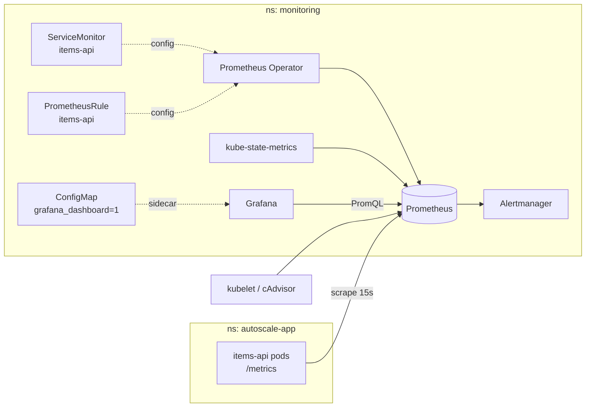

# Monitoring and Alerting (Phase 6)

Observed results are from 2026-10-15.

- kube-prometheus-stack Helm chart 92.9.0 (operator v0.94.1).
- Prometheus, Alertmanager, Grafana 13.2.4 and kube-state-metrics.
- kind v1.37.0.


*The dashboard with real traffic: 38.6 req/s, 0% errors, p95 4.76 ms. The replicas panel shows the simulated outage at about 16:18, where available replicas fell to 0 and came back to 2.*

## 1. How the pieces fit



- **Helm** installs the stack: `monitoring/values-local.yaml`.
- **`kubectl apply -k monitoring`** adds this project's objects:
  - the ServiceMonitor,
  - the alert and recording rules,
  - the dashboard.
- **Prometheus Operator:** watches ServiceMonitor and PrometheusRule objects and rewrites Prometheus' config. Nobody edits `prometheus.yml` by hand.
- **Grafana sidecar:** loads every ConfigMap labelled `grafana_dashboard: "1"`. The dashboard JSON lives in git, which makes it *dashboards as code*.

## 2. Where each metric comes from

| What you see | Metric | Source |
|---|---|---|
| Request count, rate, by route/status | `http_requests_total` | **App** (`app/metrics.py`) |
| Error rate | `http_requests_total{status=~"5.."}` ÷ all | **App** |
| Latency p50/p95/p99 | `http_request_duration_seconds_bucket` | **App** histogram |
| In-flight requests | `http_requests_in_progress` | **App** gauge |
| Availability | `up{job="items-api"}` | **Prometheus** (did the scrape succeed) |
| Pod CPU | `container_cpu_usage_seconds_total` | **kubelet / cAdvisor** |
| Pod memory | `container_memory_working_set_bytes` | **kubelet / cAdvisor** |
| CPU/memory requests and limits | `kube_pod_container_resource_requests` / `_limits` | **kube-state-metrics** |
| Replicas, HPA current/desired/max | `kube_deployment_status_replicas_available`, `kube_horizontalpodautoscaler_*` | **kube-state-metrics** |

- **Probe and scrape paths:** `/health`, `/ready` and `/metrics` are excluded from user-traffic panels and alerts. Kubernetes and Prometheus call them every few seconds, so including them would dilute error rates and latency.
- **What the HPA reads:** CPU from **metrics-server**, not Prometheus. They are separate pipelines that measure the same thing.

## 3. Alert rules

File: `monitoring/alerts/items-api-rules.yaml`

| Alert | Condition | For | Severity |
|---|---|---|---|
| `ItemsApiDown` | `(sum(up{job="items-api"}) or vector(0)) == 0` | 1m | critical |
| `ItemsApiHighErrorRate` | 5xx ÷ user requests > 5% | 2m | critical |
| `ItemsApiHighLatency` | p95 > 500 ms | 5m | warning |
| `ItemsApiAutoscalerAtMax` | HPA current ≥ max replicas | 10m | warning |

- **Recording rules** precompute request rate, error rate and p95. Alerts and dashboards reuse them.
- **`or vector(0)`:** when every pod is gone, there are no `up` series at all, and `sum(up) == 0` would return nothing and **never fire**. The unit tests prove both that this case fires and that the alert depends on `or vector(0)`.
- **`ItemsApiAutoscalerAtMax`:** added because of Phase 5, where the HPA was pinned at 6 replicas with CPU still at about 150%.
- **Alertmanager:** uses the chart's default `null` receiver. Alerts are visible in its UI and API but not sent anywhere. To send them, add a Slack or email receiver whose credentials come from a Kubernetes Secret, never from git.

### Unit tests for rules

Run:

```bash
make test-alerts
```

- **What it does:** extracts the rule groups from the PrometheusRule (`scripts/extract_rules.py`), runs `promtool check rules`, then runs `promtool test rules` against `monitoring/alerts/items-api-rules.test.yaml`.
- **Test cases:** 11, covering:
  - fires above each threshold,
  - silent below each threshold,
  - pending vs firing timing,
  - no traffic (no divide-by-zero),
  - all pods gone,
  - 5xx on probe paths ignored.
- **Proving the tests can fail:** each rule was broken on purpose, and promtool caught each break.

| Deliberate break | Caught by |
|---|---|
| Error threshold 5% → 50% | `error rate of ~9% fires after 2 minutes` |
| Removed `or vector(0)` | `down when there are no scrape targets at all` |
| Counted probe paths as user traffic | `500s on probe paths are ignored` |

## 4. Evidence (observed)

### Install

- `helm upgrade --install ... --version 92.9.0` finished in 2 min 34 s, with 5 pods Running.
- Disk use went from 18 GB to 16 GB free.
- **Turned off, and why:**
  - node-exporter: on kind, its "host" is Docker's VM, so its numbers would be misleading.
  - etcd, controller-manager, scheduler and kube-proxy scraping: kind binds them to 127.0.0.1, so their targets would be permanently DOWN and their alerts permanently firing.

### Targets

- 12 scrape pools, all up: apiserver, kubelet ×3 endpoints, coredns, kube-state-metrics, operator, Prometheus, Alertmanager, Grafana.
- **Bug found:** `items-api` was **missing**. A ServiceMonitor selects Services by their **own metadata labels**, and the Service only had `app.kubernetes.io/name` in its pod selector.
  - **Fix:** add the label to `k8s/base/service.yaml` metadata.
  - **After the fix:** `serviceMonitor/monitoring/items-api/0 2/2 up`.
- While the target was missing, `ItemsApiDown` went **pending** on its own, an unplanned confirmation that the alert works.

### Every dashboard query checked

- All 21 panel queries were run against Prometheus while traffic flowed, and **0 returned empty**.
- Examples:
  - request rate 13.1 req/s,
  - p95 4.8 ms,
  - pod CPU 0.034 cores vs 0.1 request,
  - memory 38 MiB vs 192 MiB limit,
  - HPA current 2 and max 6.

### Two misleading panels found and fixed

1. **"In-flight requests" showed 1 per pod while idle.** The gauge counted the Prometheus scrape that was reading it.
   - **Fix:** the app no longer counts `/metrics` itself (`app/metrics.py`), with a new test `test_in_progress_gauge_excludes_the_scrape_itself`. The test fails on the old code and passes on the new.
   - Shipped as image **v3** with `newTag: v3`. Idle pods now report 0.
2. **"Requests in range" was red.** It had no thresholds, so Grafana's default (red above 80) painted 13.6 K healthy requests red.
   - **Fix:** volume stats use a fixed neutral colour. Health stats keep meaningful thresholds:
     - error rate: orange at 1%, red at 5%,
     - p95: orange at 250 ms, red at 500 ms,
     - availability: red below 99%.

### Live alert: `ItemsApiDown` (simulated outage, `kubectl scale --replicas=0`)

| t | Prometheus | Alertmanager |
|---|---|---|
| 0 s (23:17:49Z) | inactive | — |
| 37 s | **pending** | — |
| 99 s | **firing** | **active**, `severity=critical`, receiver `null` |
| 100 s | scaled back to 2 | |
| 128 s | resolved | resolved |

- **Detection took 99 s:** up to about 30 s for the last scrape to go stale, plus the `for: 1m`.
- **Faster detection means more false alarms.** Shorter `for` values page on brief blips.
- **HPA after the outage:** scaling to 0 pauses the HPA. After scaling back to 2 it resumed, reading `cpu: 25%/60%` about a minute later.

### Incident during this phase (real, not simulated)

- **Symptom:** the Grafana dashboard went blank twice, with `ERR_CONNECTION_REFUSED` and then "Failed to load dashboard".
- **Detection:** `kubectl get pods` showed 2 restarts on Grafana, and `lastState.terminated.reason` was **OOMKilled** (exit 137).
- **Root cause:** the 384 Mi limit I set in `values-local.yaml` was too small. Prometheus showed Grafana's working set peaking at **383 MiB**.
- **Fix:** request 256 Mi and limit 768 Mi (about 2× the measured peak), applied with `helm upgrade`.
- **Verification:** 0 restarts afterwards, working set 339 MiB.
- **Lesson:** set limits from measurement, not guesses, and alert on restarts. The chart's built-in `KubePodCrashLooping` rule covers this.

## 5. Commands

Install everything:

```bash
helm repo add prometheus-community https://prometheus-community.github.io/helm-charts
```

```bash
kubectl create namespace monitoring
```

```bash
kubectl -n monitoring create secret generic grafana-admin --from-literal=admin-user=admin --from-literal=admin-password="$(openssl rand -base64 18)"
```

```bash
helm upgrade --install monitoring prometheus-community/kube-prometheus-stack --version 92.9.0 -n monitoring -f monitoring/values-local.yaml --wait --timeout 10m
```

```bash
kubectl apply -k monitoring
```

Open the UIs, one terminal each:

```bash
kubectl -n monitoring port-forward svc/monitoring-grafana 3000:80
```

```bash
kubectl -n monitoring port-forward svc/monitoring-kube-prometheus-prometheus 9090:9090
```

```bash
kubectl -n monitoring port-forward svc/monitoring-kube-prometheus-alertmanager 9093:9093
```

Grafana admin password:

```bash
kubectl -n monitoring get secret grafana-admin -o jsonpath='{.data.admin-password}' | base64 -d; echo
```

- The dashboard is at http://localhost:3000/d/items-api/items-api-health.
- If a port-forward stops with "connection refused", the pod behind it restarted. Check `kubectl -n monitoring get pods`, then start the port-forward again.

Test an alert yourself:

```bash
kubectl -n autoscale-app scale deploy/items-api --replicas=0
```

- Within about 2 minutes, `ItemsApiDown` fires at http://localhost:9090/alerts and http://localhost:9093.
- Restore it with `kubectl -n autoscale-app scale deploy/items-api --replicas=2`.

## 6. Known limitations

- **Short retention:** 2 days, and Prometheus stores data in an `emptyDir`, so a Prometheus pod restart loses history. Production needs a PersistentVolume, or remote storage such as Thanos or Mimir.
- **Single instances:** one Prometheus replica and one Alertmanager, so there is no HA.
- **Alerts don't notify anyone:** the receiver is `null`. Notifications need a receiver with secret-managed credentials.
- **Error and latency alerts not yet triggered live:** only their unit tests have exercised them. Phase 7 adds fault injection to fire them for real.
- **Percentiles are estimates:** they are interpolated within histogram buckets (5 ms … 5 s), so p95 = 4.76 ms means "between 2.5 ms and 5 ms".
