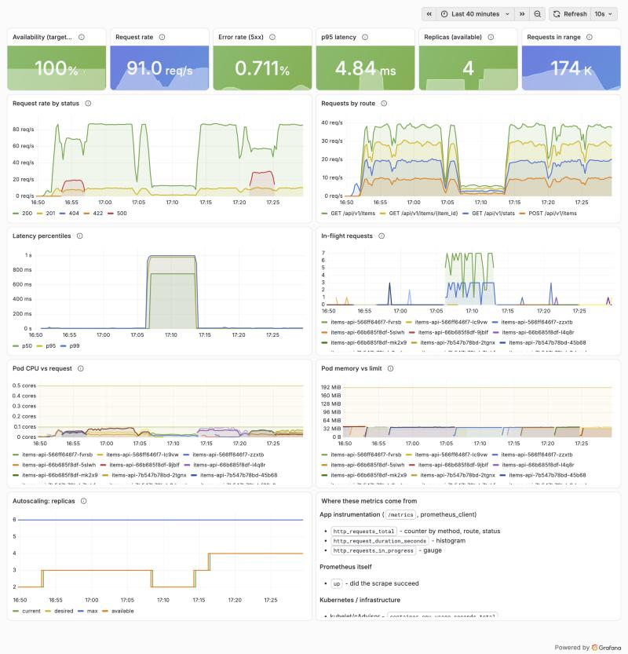

# Troubleshooting and Failure Drills

> **Simulated vs actual.** Scenarios A–D below are **simulated** failure drills, run on purpose on 2026-10-15 against the local kind cluster, with real traffic and real alerts.
>
> Incidents that happened by accident while building the project are marked **ACTUAL** in section 3. The written postmortem is in [incident-postmortem.md](incident-postmortem.md).



*From left to right:*
- *B: a band of 500s at about 16:53.*
- *C: p95 jumps to about 1 s at about 17:06, while throughput drops, in-flight requests rise and replicas fall from 3 to 2.*
- *D: 500s on one route at about 17:21.*

*Times are US Pacific. The UTC times in the tables are 7 hours later.*

## 1. First five minutes of any incident

Work from the outside in: what users see, then what changed, then where it breaks.

1. **Is it real, and how big?** Open the Grafana "Items API Health" dashboard and check:
   - error rate,
   - p95 latency,
   - availability,
   - replicas.
2. **What fired?** Check the alerts:
   - Prometheus: http://localhost:9090/alerts
   - Alertmanager: http://localhost:9093
3. **What changed recently?**

   ```bash
   kubectl -n autoscale-app rollout history deploy/items-api
   ```

   ```bash
   kubectl -n autoscale-app get rs --sort-by=.metadata.creationTimestamp -o 'custom-columns=RS:.metadata.name,DESIRED:.spec.replicas,IMAGE:.spec.template.spec.containers[0].image'
   ```

4. **Where is it failing?** Errors by route:

   ```bash
   kubectl -n monitoring port-forward svc/monitoring-kube-prometheus-prometheus 9090:9090
   ```

   Then query `sum by (path) (rate(http_errors_total{job="items-api"}[2m]))` at http://localhost:9090.

   - One route failing points to **code**.
   - Every route failing points to **config, a dependency, or the platform**.

5. **Mitigate first, investigate second.** If a release or config change lines up with the start of the problem, roll it back now and find the root cause afterwards.

Three gotchas found while running these drills:

- **`kubectl logs -l <selector>` shows only the last 10 lines per pod by default.**
  - In Scenario B it reported 4 errors when there were 2,315.
  - Always add `--tail=-1`, together with `--since=` to bound it.
- **`rollout history` notes can be stale.**
  - The `kubernetes.io/change-cause` annotation is copied to later revisions until someone overwrites it.
  - Trust the ReplicaSet images and the pod template instead.
- **Alerts resolve minutes after the fix.**
  - The error and latency alerts use 5-minute windows, so they stay firing after users stop seeing errors.
  - To check whether recovery has really happened, use a **1-minute** query:
    ```
    (sum(rate(http_requests_total{job="items-api",status=~"5.."}[1m])) or vector(0))
      / sum(rate(http_requests_total{job="items-api",path!~"/health|/ready|/metrics"}[1m]))
    ```

## 2. Scenarios

### Scenario A: a pod unexpectedly terminates (simulated)

| | |
|---|---|
| **Symptoms** | Usually none for users. A pod disappears and a new one appears. Without draining, a handful of `connection refused` errors. |
| **Detection** | `kubectl get pods` shows a new pod name or `restarts` > 0. Pod events show `Killing`. For crashes, alert on restarts (the chart's `KubePodCrashLooping`). |
| **Investigation** | `kubectl -n autoscale-app get events --sort-by=.lastTimestamp` · `kubectl -n autoscale-app describe pod <pod>` (Last State, Reason: `OOMKilled`, `Error`, exit code) · `kubectl -n autoscale-app logs <pod> --previous` |
| **Likely root causes** | Node drain or eviction · OOMKilled (memory limit) · liveness probe failures · crash on an unhandled startup error · someone deleted it |
| **Recovery** | Automatic: the ReplicaSet creates a replacement. Manual action only if it keeps happening (CrashLoopBackOff). |
| **Verification** | `kubectl -n autoscale-app get deploy items-api` shows READY = desired. Error rate unchanged. |
| **Prevention** | ≥2 replicas spread across nodes · readiness probe plus `preStop` sleep for clean draining · memory limits set from measured usage · restart alerts |

**Drill:**

```bash
./scripts/pod-kill-drill.sh
```

| Run | Version | Requests (~10/s) | Failed | Victim drained in |
|---|---|---|---|---|
| Phase 4 (no preStop/readiness) | v1 | 391 / 385 | **2 / 1** | 0.9 s / 0.5 s |
| Phase 5 (preStop 5 s + readiness) | v1 | 392 / 388 | **0 / 0** | 5.8 s / 6.2 s |
| Phase 7 | v4 | 392 | **0** | 6.4 s |

### Scenario B: the application returns HTTP 500 errors (simulated)

- **Simulation:** a bad config push.

  ```bash
  kubectl -n autoscale-app set env deploy/items-api FAULT_ERROR_RATE=0.2
  ```

- **Traffic:** about 95 req/s of steady k6 traffic (`DURATION=12m ./scripts/run-load-test.sh steady`).

| | |
|---|---|
| **Symptoms** | About 20% of requests fail with `500 {"detail":"Internal server error"}` on **every** `/api/v1` route. Pods look perfectly healthy. |
| **Detection** | `ItemsApiHighErrorRate` (5xx > 5% for 2 m). Grafana's error-rate stat and the red `500` series. |
| **Investigation** | errors by route (all routes → shared cause) · `kubectl -n autoscale-app logs -l app.kubernetes.io/name=items-api --tail=-1 --since=5m \| grep '"status": 500'` · the pod template env: `kubectl -n autoscale-app get deploy items-api -o jsonpath='{.spec.template.spec.containers[0].env}'` · `GET /api/v1/stats` shows `faults` |
| **Likely root causes** | Bad config/env change · failing downstream dependency · resource exhaustion · a bug in shared middleware |
| **Recovery** | `kubectl -n autoscale-app rollout undo deploy/items-api`, or remove the variable with `kubectl ... set env deploy/items-api FAULT_ERROR_RATE-` |
| **Verification** | 1-minute error rate returns to 0. The alert resolves a few minutes later. |
| **Prevention** | Config changes go through git and review (Kustomize ConfigMap hash triggers a visible rollout) · canary rollout with automatic analysis · error-rate alert with a runbook link |

**Observed timeline** (t=0 at 23:52:55Z, when the variable was set):

| t | Event | 1-min error rate | 5-min error rate |
|---|---|---|---|
| 0 s | `set env FAULT_ERROR_RATE=0.2`; rollout done in a few seconds | 0% | 0% |
| 60 s | alert **pending** | 19.6% | 7.8% |
| 181 s | alert **firing** in Prometheus and Alertmanager | 19.8% | 13.5% |
| 203 s | **mitigation:** `rollout undo` | 20.4% | 14.4% |
| ~270 s | users stop seeing errors | **0.0%** | 13.6% |
| 452 s | alert **resolved** | 0.0% | 4.9% |

- **k6 client view (12 min):** 69,002 requests, 5.59% failed overall (20% for about 3.5 min).
- **Investigation evidence:**
  - Errors were spread across `/api/v1/items`, `/api/v1/items/{item_id}` and `/api/v1/stats`.
  - The logs held 2,315 `500` lines in 2 minutes (with `--tail=-1`).
  - The startup log said `FAULT INJECTION ENABLED: error_rate=0.2`.
  - The pod env showed `FAULT_ERROR_RATE=0.2`.

### Scenario C: the application becomes slow under load (simulated, plus one natural observation)

**Simulation:** a slow downstream dependency.

```bash
kubectl -n autoscale-app set env deploy/items-api FAULT_LATENCY_MS=600
```

The fault adds 600 ms of *waiting*, not CPU work, to every `/api/v1` request.

| | |
|---|---|
| **Symptoms** | Every API call takes about 0.6 s instead of about 5 ms. Throughput drops. No errors. |
| **Detection** | `ItemsApiHighLatency` (p95 > 500 ms for 5 m). The latency panel jumps, and in-flight requests rise. |
| **Investigation** | latency by route (all routes → shared cause) · CPU per pod (**low**, so not CPU-bound) · `http_requests_in_progress` (high: requests are waiting) · recent changes · env / `GET /api/v1/stats` → `faults.latency_ms` |
| **Likely root causes** | Slow dependency (database, external API) · CPU throttling at the limit · too few replicas · lock contention · GC pauses |
| **Recovery** | Remove the cause (`kubectl ... set env deploy/items-api FAULT_LATENCY_MS-`). For CPU-bound slowness, add capacity: raise `maxReplicas` or the CPU limit. |
| **Verification** | 1-minute p95 back to about 5 ms, and throughput back to normal. |
| **Prevention** | Latency alert (CPU-based autoscaling is blind to waiting) · timeouts and circuit breakers on dependencies · scale on request rate or in-flight requests (KEDA or prometheus-adapter) |

**Observed timeline** (t=0 at 00:05:58Z, 10 k6 users):

| t | req/s (1m) | p95 (1m) | total CPU (cores) | replicas | Event |
|---|---|---|---|---|---|
| −30 s | 95 | 5 ms | 0.164 | 3 | baseline |
| 0 s | | | | | `set env FAULT_LATENCY_MS=600` |
| 90 s | **14** | **975 ms** | 0.052 | 3 | alert pending at 102 s |
| 150 s | 14 | 975 ms | 0.044 | **2** | **HPA scaled DOWN** |
| 401 s | 14 | 975 ms | 0.040 | 2 | alert **firing** |
| 426 s | | | | | **mitigation:** variable removed |
| 671 s | 96 | 4.8 ms | | | alert resolved |

What this drill teaches:

1. **CPU-based autoscaling is blind to waiting.**
   - Waiting costs no CPU, so CPU fell from 0.164 to about 0.04 cores.
   - The HPA saw an idle service and **removed** a replica in the middle of a latency incident.
   - Only the latency alert caught it.
2. **Throughput dropped 7×, and that wasn't a capacity limit.**
   - k6 uses a closed model: each of the 10 users waits for a response before sending the next request.
   - 10 users ÷ (0.6 s + 0.1 s think time) ≈ 14 req/s.
   - Real users with a fixed arrival rate would instead pile up as in-flight requests and timeouts.
3. **Histogram percentiles are bucket estimates.**
   - Prometheus reported p95 = 975 ms, while k6 measured the real client-side p95 as **607 ms**.
   - Every request fell in the 0.5–1 s bucket, and `histogram_quantile` interpolates within it.
   - Tighter buckets around the SLO would give more accurate values.

**Natural observation from the ramp test** (no fault injected):

- At 572 req/s across 6 pods, a pod was throttled in **40% of its CPU periods**, even though its average CPU was 0.24 cores, under the 0.5 limit.
- Python's bursty CPU use runs into the 100 ms CFS window before the average shows it.
- The worst 1-minute p99 reached 105 ms, against a normal p99 of about 5 ms.
- Raising the CPU limit or adding replicas reduces it.
- See [load-test-results.md](load-test-results.md).

### Scenario D: a deployment introduces a regression (simulated)

**Simulation:** a release with a code bug.

```bash
./scripts/build-regression-image.sh
```

```bash
kind load docker-image items-api:v5-regression --name autoscale
```

```bash
kubectl -n autoscale-app set image deploy/items-api api=items-api:v5-regression
```

- **The bug:** `GET /api/v1/items/{item_id}` reads a missing `tags` key and raises `KeyError`.
- **Why the rollout succeeds:** `/health` and `/ready` still pass.

| | |
|---|---|
| **Symptoms** | Single-item reads always fail with 500. Lists, stats and creates work. The rollout reported **success**. |
| **Detection** | `ItemsApiHighErrorRate`. The 500 series in Grafana is limited to one route. |
| **Investigation** | errors by route (**one** route → code) · error share per route (100% on that route) · logs: `unhandled exception` with traceback and `request_id` · ReplicaSet images (newest is `v5-regression`) |
| **Likely root causes** | Code bug not covered by tests · schema or contract mismatch · missing migration · dependency version change |
| **Recovery** | `kubectl -n autoscale-app rollout undo deploy/items-api`, which goes back to the previous ReplicaSet (v4) |
| **Verification** | 1-minute error rate 0 · image is `items-api:v4` · `kubectl diff -k k8s/overlays/local` shows no drift |
| **Prevention** | Unit tests for every route (CI blocks merging) · smoke test after each deploy · canary or progressive delivery with automatic rollback on error rate · a readiness probe can't catch functional bugs, so don't rely on it for that |

**Observed timeline** (t=0 at 00:20:48Z):

| t | Event |
|---|---|
| 0 s | `set image ... v5-regression` |
| 11 s | `deployment "items-api" successfully rolled out`, with all 4 new pods Running and Ready, 0 restarts |
| 85 s | alert **pending** (5-min error rate 5.9%) |
| 201 s | alert **firing** (19.1%) |
| 201–228 s | investigation (below) |
| 228 s | **mitigation:** `rollout undo` → image `items-api:v4` |
| 284 s | 1-minute error rate back to **0** |
| 505 s | alert **resolved** |

Investigation output:

```
errors by route (2m):   {'path': '/api/v1/items/{item_id}'} 28.9 req/s     <- only this route
error share per route:  {'path': '/api/v1/items/{item_id}'} 1              <- 100% failing
log:   request_id: 6530b5f735b240e589190b440835ddf1 | path: /api/v1/items/1
       exception : KeyError: 'tags'
       raised at : File "/app/app/routes/items.py", line 51, in get_item
newest ReplicaSet: items-api-66b685f8df  4  items-api:v5-regression
```

- The overall error rate was about 30%, because about 30% of the k6 mix is single-item reads.
- **The key lesson:** Kubernetes judged the release healthy. Health checks prove the process is alive, not that it is correct.

## 3. Environment and platform problems found while building (ACTUAL)

These happened unplanned. Each one shows a symptom far from its cause.

| Symptom | Real cause | Fix |
|---|---|---|
| kind nodes stuck `NotReady`; `kubectl` timeouts; `docker` says `input/output error` | Mac's disk 98% full, so Docker Desktop's VM disk started failing writes | Free disk space (≥20 GB), restart Docker Desktop, recreate the cluster. Cap Docker's disk in Settings. |
| `kubectl` warns about version skew, or odd errors | Docker Desktop's bundled kubectl 1.34 vs cluster 1.37 | `brew install kubernetes-cli` (1.37), earlier in `PATH` |
| `items-api` target missing in Prometheus; `ItemsApiDown` pending | Service had no `app.kubernetes.io/name` label of its own; a ServiceMonitor selects **Services**, not pods | Add the label to the Service metadata |
| Grafana blank, then "Failed to load dashboard" | Grafana **OOMKilled** at a 384 Mi limit (peak 383 MiB) | Limit 768 Mi. See [incident-postmortem.md](incident-postmortem.md). |
| "In-flight requests" = 1 on idle pods | The gauge counted the `/metrics` scrape itself | Exclude `/metrics` from the gauge (app v3) |
| `kubectl apply -k` silently rolled the app back to an old version | An earlier `kubectl set image` wasn't reflected in `newTag` | Deploy by changing `newTag` in git. After an emergency `set image` or `undo`, commit the matching change. |
| Removing `replicas:` from the Deployment briefly dropped it to 1 pod | `kubectl apply` reset the field to its default | Hand replica control to the HPA before removing the field |
| port-forward dies with `connection refused` | The pod behind it restarted (port-forward pins one pod) | `kubectl get pods`, then restart the port-forward |
